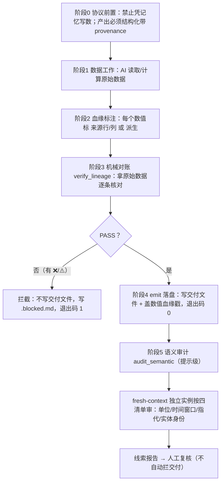

# AI 数据核对（数值血缘防偷懒）

## ⚠️ 先读这三条（避免误判"这工具啥也没干"）

1. **它不检查你现有的报告，它要求你按协议产出。**
   本工具不是"丢一个 md 文件进去就能验"。它要求 AI 在产出数据结论时，
   每个数字都附带一句"我从原始数据的哪来的"（血缘标签）。
   你若直接拿一份没有血缘标签的普通报告去跑，会拿到 **exit 2**。

2. **`exit 2` ≠ 通过，是"没按协议写"。**
   退出码 `2` 的含义是「未解析到任何带标签的数值声明」，即你的产出格式不符合协议。
   **不是**"检查通过"，也不是"工具坏了"。

3. **最小可用示例就在下面**，复制即可跑通。完整样例见 `samples/`。

## 最小可用示例（复制即跑）

**第 1 步**：假设原始数据 `data.csv`：
```csv
product,amount
A,100
B,250
```

**第 2 步**：让 AI 产出结构化结果 `claims.json`（每个数字带出处）：
```json
{"claims": [
  {"label": "A产品金额", "value": 100, "source": {"row": 1, "col": "amount"}},
  {"label": "金额总额", "value": 350, "derived": {"op": "sum", "col": "amount"}}
]}
```

**第 3 步**：通过产出通道落盘（**不要手写交付文件**，见下节）：
```bash
python emit.py --source data.csv --claims claims.json --out 报告.md
```
- 校验通过 → 写 `报告.md` 并盖数值血缘戳，退出码 0
- 校验不通过 → **不写** `报告.md`，改写 `报告.md.blocked.md`，退出码 1

## 它解决什么

**用了之后，AI 统计/汇总数据时不会瞎说、不会偷懒。**

它不敢凭记忆编数、不会把数字抄错、不会把单位或实体搞混——因为它交活时每个数字都必须写明出处，
再由独立脚本拿你的原始数据逐条核对，对不上的直接拦住，文件都不给你落盘。

问题出在哪儿呢？你让 AI 统计一份数据，AI 在产出里把**部分数据复制黏贴 / 凭记忆写数**，
导致结果跟原始数据对不上——你只能自己一行行翻原始文件去核对。
这个 skill 不靠"读 AI 内心"判断它偷没偷懒，而是把问题变成**可机械验证**的：

> AI 交活时，每个数字必须声明"我从原始数据的哪来的"；脚本拿原始数据逐一核对这份声明。声明和现实对不上 = 抄错 / 算错 / 编数。

这是「消费者视角验证」：不依赖 AI 自证，用独立脚本拿真值对账。

## 适用范围（重要，别误期待）

**适用**：结构化数值产出的核对——统计表、汇总数字、报表指标、清单数值。
**不适用**：自由文本/散文/创意写作的质量校验；代码正确性验证；非数值类内容。

**诚实边界**：本工具只在 1 个真实任务 + 若干样本上验证过，**发布不等于验证充分**。
它不是通用验证器，别把它当万能质检。它抓的是"数字和它的出处对不对得上"。

## 使用协议（做数据工作时必须遵守）

1. **禁止凭记忆/印象写任何数字**。所有数值必须从已加载的原始数据读取或计算。
2. **产出必须结构化**，每个数值带 provenance 标签，两种写法都行：
   - JSON 清单（最稳）：见 `samples/ai_output_clean.json`
   - 行内标签文本：`A产品金额=100 | 来源: 行1 列amount` / `总额=1000 | 派生: sum(amount)`
3. **只能通过 `emit.py` 写交付文件**（强制收尾，见下节）。对账逻辑已焊进产出通道：
   不通过校验，交付文件根本落不了盘；报告里任何 ❌ / ⚠️ 一律拦截。
4. **机械 PASS 后，建议再过语义审计**（第二道闸门，提示级）：`audit_semantic.py`。
   机械闸门锚「值 ↔ 单元格」，语义审计锚「**单元格 ↔ 语义实体**」——
   值对得上不代表指的实体/时间/单位/指代对。

## 强制收尾：emit.py 产出通道（防「软约束被无视」）

`verify_lineage.py` 单独跑是**软约束**——AI 可以无视它直接交付。`emit.py` 把校验焊进
**产出通道**：AI 只能通过它落盘，它内部 生成→自校验→FAIL 拒绝落盘。

```
python emit.py --source <原始数据> --claims <AI产出> --out <交付文件路径>
```

- PASS：写交付文件（含数值血缘戳：状态/时间/源），退出码 0。
- FAIL（有错位/无法验证）：**绝不写交付文件**，改写 `<out>.blocked.md` 隔离报告，退出码 1。

### 强制力的诚实边界（务必看）
- `emit.py` 是**协议层**强制：它让"正确路径"成为唯一能产出有效交付物的路径，且是
  **唯一被认可的产出通道**。
- 但纯靠协议，AI 理论上仍可用别的手段直接写文件——**真正的硬闸门需要框架级
  pre-delivery hook 调 `emit.py`**。本文件即 hook 会调用的 Enforcement 代码，将来接 hook
  无需返工。
- 无论走 hook 还是纯协议：**未经 `emit.py` 通过的文件，按本协议一律视为「非交付物」**。

## 内部对账（verify_lineage.py）

`emit.py` 复用 `verify_lineage.py` 的对账逻辑，可单独跑做诊断：
```
python verify_lineage.py --source <原始数据> --claims <AI产出>
```

## 第 4 层：结论链检查（结论 ↔ 证据链）

前三层只看「数字」；第 4 层是唯一看「**结论与数字的绑定关系**」的层。
**不重算结论真伪**（那是制造第二份真值），只查**证据链是否成立**。

启用方式：claims 文件顶层加 `conclusions` 数组，结论用 `evidence` 引用带 `id` 的 claim。

| 检查 | 级别 | 查什么 |
|---|---|---|
| H1 引用完整性 | **硬拦** | 悬空引用 / 引用了未 PASS 的证据 / claim id 重复 / **因果·建议·预测类未标 `verifiability:"manual"`（中英别名都认）** / criterion 缺 `source` |
| H2 数值矛盾 | **硬拦** | 结论里的数字与被引证据"接近但不相等"（抄错） |
| H3 阈值矛盾 | **硬拦** | 自称满足 criterion 但实际不满足；**`criterion.metric` 匹配不上任何被引 claim 的 label/id 也硬拦**（阈值不可核验不得静默通过） |
| H4 方向矛盾 | **硬拦** | 结论声称方向与证据显式方向矛盾（**只查显式矛盾，不验因果**） |
| W1 裸数字 | 提示 | 结论里的数字在被引证据中找不到（**提示级，不阻断落盘**，但会列进交付件「提示」段） |

> **`type` 取值（v0.5.2）**：因果/建议/预测类可用中文——`因果` / `建议` / `预测`（以及
> `causal` / `recommend` / `recommendation` / `forecast` 等英文别名），**写了就强制 `manual`**。
> 描述类：`descriptive` / `relational` / `caveat` / `事实` / `关系` / `比较` 等。**未知类型会告警**，不再静默。

**不查**：因果/建议/预测类结论的真伪（无 ground truth）；措辞与逻辑跳跃（交第 3 层）。

**已知边界（诚实声明）**：
- 自声明阈值**可被放宽以规避**（AI 可写 `p<=0.99` 让 p=0.5 也自洽）——机器只查自洽，**不查阈值合理性**，那是领域知识。缓解：`criterion` 必须带 `source` 留痕可审。
- **证据选择偏差查不出来**（只引支持自己的证据、漏引反证）→ 靠人工抽查。
- 第 4 层**不能验因果方向**。
- 裸数字检测（W1）带**词法白名单**（v0.5.0）：只放过结构性叙述数字
  （年份 / 序数排名 / 季度标签 / 窗口区间计数 / 带约数词的倍数），
  **不放过**任何测量值（样本量、金额、百分比、效应量、无约数词的倍数）。
  实测误报率 **100%（9/9）→ 0%（0/9）**，同时反向测试 **0/8 假阴性**
  （真信号一条没漏）。白名单是**词法**的不是语义完美的：
  "第 800 名"会被放过——它与证据里的 798 数值接近，但语义是排名不是测量值，
  放过比误报硬拦更正确（H2 的判定理由必须准确）。

单独运行：`python verify_conclusions.py --source <源> --claims <claims>`

## 三个判定

- ✅ **命中**：标签指向的单元格 / 派生结果与 AI 写的一致。
- ❌ **错位**：标签对但数值不符 → 抓到"抄错 / 算错 / 编数"。
- ⚠️ **无法验证**：AI 没标来源 → 本身就是红色信号（懒得查）。

对派生统计（sum/mean/count/min/max），脚本直接从原始数据**重算**再比对。

## 支持的数据源

- 原始数据：`.csv`（默认，纯 stdlib，零依赖）、`.json`（对象数组）。
- AI 产出：`.json`（清单）或 `.md`/`.txt`（行内标签）。
- 想试 xlsx 分支：装 `openpyxl` 后运行 `python samples/_make_demo.py` 生成演示 xlsx
  （发布包内不放 xlsx，因上传接口禁止二进制）。
- XLSX（**已接入 ①**）：`openpyxl` 只读分支（`read_only=True, data_only=True`），**不引入 pandas**。
  五个坑已处理：公式无缓存值显式报错（防假 PASS）、首行表头/R1 首数据行与 csv 一致、默认第一个 sheet 并在报告标注 sheet 名、缺 `openpyxl` 显式报错不降级。列按表头名引用（与 csv 一致；`C3` 位引用暂不支持）。
- Parquet（**已接入**）：单独 `pyarrow` 可选分支，缺依赖时显式报错（exit 3）而非假装 PASS。
  五个坑已处理：① `pyarrow` 缺失 → 干净报错不降级；② 分批读（`iter_batches`）避免大表打爆内存；
  ③ 列名取 schema（空表也报"无任何行"），不静默 PASS；④ 值统一转字符串（NaN/None → `""`），
  与 json 分支一致，文本身份比对不失真；⑤ 损坏文件/非 parquet → 干净报错不漏 traceback。
  类型归一化：`bool` → `True/False`；时间戳 → ISO 字符串；`Decimal`/数值 → `str()`；
  `bytes` → utf-8 解码；嵌套列（list/dict）→ JSON 文本。
  **⑥ 全空行保留（v0.5.2）**：不再静默丢弃全空行。丢弃会让 `source.row` 与物理行整体错位，
  而每条 claim 仍可能 PASS——那正是本工具最该防的"实体错位"却成盲区。报告中会标
  `物理行对齐` 或 `⚠行号与物理行不一致`，并对全空行计数。
  **等价性**：同一份数据存成 csv 与 parquet，两分支的对账结论逐条一致（数值等价，非字面相等——
  csv 的 `amount` 是文本 `"100"`、parquet 是 float64 → `"100.0"`，数值都是 100.0）。
  想试 parquet 分支：装 `pyarrow` 后运行 `python samples/_make_parquet.py` 生成演示样本
  （发布包内不放 .parquet，因上传接口禁止二进制）。

## 局限（诚实边界）

- 抓不到"值"和"来源"被 AI **同时**写错且恰好自洽的极端情况（概率极低，可抽查发现）。
- 完全自由文本、无结构、无标签的数字无法验证——所以协议强制结构化产出。
- 原始数据本身有错属于数据质量问题，不是 AI 偷懒，脚本不负责。
- **漏采的文件查不出来**：没被采集进备料包的文件，不会出现在任何校验里。
  防这类错要另做"源文件全集 vs 已采集合"的显式对账，本工具不管这件事。

## 回归自测（一条命令跑完全部用例）

```bash
python tests/run_all.py
```

27 个用例覆盖：机械对账（csv/离散行集/xlsx/公式无缓存值/claim id 唯一性）、
parquet（与 csv 分支等价/类型归一化/缺依赖/损坏文件）、结论链（正例 + 五个阴性对照 +
误报探针）、词法白名单双向、语义审计（备料/汇总/清单外线索）、emit 落盘闸门、打包自检，
以及 **v0.5.2 九项修复的逐条回归**（nulls/countdistinct、rows 空集+多区间、全空行保留、
type 中文别名、criterion 模糊匹配/硬拦、emit 渲染结论、覆盖率门槛、重复 id exit 1）。

**跳过必须显式计数**（依赖/二进制样本缺失时逐条打印，不静默充数——这也是 v0.5.2 修掉的一个
既有诚实性缺陷：此前缺 pyarrow 的用例会手写 print 却不计入跳过数，仍显示 ✅）：
- 完整环境（装了 `openpyxl` + `pyarrow`）→ **通过 27 ｜ 跳过 0**
- 无 `pyarrow` 环境 → **通过 22 ｜ 跳过 5**（跳过明细逐条打印，不计入通过数）

```bash
python tests/run_all.py --list    # 只列用例
```

## 退出码语义（供 hook / CI 直接消费）

| 码 | 含义 |
|---|---|
| 0 | PASS：全部命中，交付文件已落盘（emit 模式） |
| 1 | FAIL：有错位或无法验证 → **不落盘**，写 `.blocked.md` |
| 2 | 未解析到任何带标签的数值声明（产出格式不对） |
| 3 | 原始数据无法加载 / 依赖缺失（含 xlsx 公式无缓存值、parquet 缺 pyarrow） |

源数据或依赖有问题时**显式报错、干净提示、绝不假 PASS**（已覆盖 `FileNotFoundError` /
`ImportError` / `ValueError` 等，不吐裸 traceback）。

## 算子与 rows 支持（v0.5.2 更新）

### 聚合算子
| 算子 | 语义 |
|---|---|
| `sum` / `mean` / `min` / `max` | 对该列**可转数值**的值聚合 |
| `count` | 数**可转数值**的个数（字符串列恒为 0，慎用；数个数用 `countrows`） |
| `countrows` | 数**行数**，与列类型无关（字符串列也适用）|
| `nulls` | 数**空值个数**（空串 / None / 字面 null·NaN；**不把非数字文本当空值**）|
| `countdistinct` | 数**去重取值个数**（空值不计入；`100` 与 `100.0` 视为同一个）|

> `count` 数的是"能转成数字的个数"，**不是**空值个数。要数空值请用 `nulls`，
> 不要用 `总行数 - count` 硬凑（那只是数值非空数，不是真空值数）。

### rows 行范围（四种形态都支持）
- 不写 / `null` / `""` → 全部数据行
- **`[]` → 空子集（0 行）** —— 与"不写"语义不同，别再指望 `[]` 表示全行
- `"1-100"` → 连续闭区间
- **`"41-829,1012-1034"` → 多区间并集**（不连续行段不必逐个列举）
- `[1,4,6,11]` 或 `"1,4,6,11"` → **离散行集**

离散行集是**显式列举**，不做任何"就近取整/补全"推断——标签写什么就核什么。

### 字符串身份校验
`source` 指向文本列时（如 `edge_id` / `from_node` 等实体名列），自动走**逐字符比对**而非数值转换，
错位会报 `文本错位`。这让「**实体名错位**」这一类（原痛点之一）也能被机械抓到。

## 真实试跑记录（陌生宿主验证）

`trial/TRIAL_REPORT.md`：拿预测系统真实数据（`factor_graph.json` 311 条边）+ **全新 AI 实例**试跑。

- **v1（修复前）**：独立实例第一次写 claims 就被拦（退出码 1，3 项错位，交付未落盘）。
  指标：自然标注 17/17、**0 漏标**；误报 0；**`⚠️ 无法验证` 占比 0%**。
- **v2（修复后同任务重跑）**：**31 条声明一次 PASS**，且第 5 项离散子集聚合值首次能被自动验证
  （v1 只能靠逐格证据人工推导）。

诚实边界：只 1 个实例 1 类任务，样本极小；未覆盖单位混淆（中/万元）；仍不能证明 AI 无法绕过 emit.py。

## v0.5.2 修复记录（真实陌生宿主试验暴露 9 项，已全部修复）

在**真实生产 parquet**（1034 行 × 19 列信号采集数据）上，用一个全新 AI 实例做简报，
干净臂 25 claims / 7 conclusions **零误报通过**；再在干净 claims 上注入 12 条单点缺陷，
**12/12 全部拦截**。试验同时暴露以下 9 项，均已修复并配回归用例：

| 编号 | 缺陷 | 修复 |
|---|---|---|
| A | `emit.py` 交付件只渲染数字表，**结论一条不落盘** | 交付件新增「结论」段（id/类型/结论/判定/证据/可核验性）+「提示」段 |
| B | `type` 只认英文，写中文"建议"**静默绕过** manual 检查 | 中英别名归一；未知类型显式告警 |
| C | `criterion.metric` 未匹配只 warn，阈值可静默不核验 | 归一化+子串模糊匹配；仍不匹配则**硬拦** |
| D | 缺 `nulls`/`countdistinct`，空值只能硬列举行号 | 新增两算子（数值归一、空值不计入去重）|
| E | `rows:[]` 被当"全部行"，空子集无法表达 | `[]` = 空集；新增多区间 `"41-829,1012-1034"` |
| F | parquet **静默丢全空行**，行号可整体错位而 claim 仍 PASS | 全空行保留；报告标 `物理行对齐`/`⚠不一致` |
| G | W1 注释称"statement 放过"而代码照扫；`strict` 形参未用 | 注释与实现对齐，删除无用形参，明确提示级不阻断 |
| H | 无覆盖率门槛，10 条也能过 | `emit.py --min-claims / --min-conclusions` |
| I | claim id 重复 → exit 3（环境类），实为内容缺陷 | 改为 exit 1 |

> 试验报告：`trial_parquet_l4/TRIAL_REPORT.md`（在本仓库外的工作目录）。

## 流程图（mermaid，纯文本语法，供 AI 直接索引）



## 第二道闸门：语义审计（提示级 · 不硬拦）

机械闸门锚「**值 ↔ 单元格**」，语义审计锚「**单元格 ↔ 语义实体**」——
值对得上不代表指的实体对。典型它能抓、机械抓不到的：标签写"华东"但那行 region 是"华南"（金额碰巧相同）。

### 为什么是"提示"而不是"硬拦"
**LLM 审计本身会误报**。拿概率性判断当硬闸门会制造假拦截，假拦截会逼人绕过闸门，整道防线反而失效。
所以：机械 FAIL = 硬拦不落盘；语义审计 = 出线索走人工复核，**脚本退出码恒为 0，无权拦交付**。

### 三步用法
```bash
# 步骤1 备料（确定性：把每条声明指向行的【身份列原文】摆出来，防审计者漏看实体列）
python audit_semantic.py prepare --source <源> --claims <claims> --out trial/audit_packet.json

# 步骤2 把 audit_packet.json + SEMANTIC_AUDIT_PROMPT.md 交给 fresh-context 独立实例，
#        产出 findings.json（格式见提示词）
#        ⚠️ 必须是独立实例：同一实例回看自己的产出会合理化

# 步骤3 汇总线索报告 + lint 越界
python audit_semantic.py finalize --packet trial/audit_packet.json \
    --findings trial/findings.json --out trial/semantic_audit.md
```

### 固定检查清单（六项，逐项过，不许笼统问"你对吗"）

**声明级**（对每条 claim 过一遍）
| item | 检查什么 |
|---|---|
| `unit` | 单位混淆：中/万元、百分数 vs 小数、千分位误读 |
| `window` | 时间窗口错位：同一实体不同期间取错行 |
| `ref` | 指代错位："该产品/该公司"指到了别的行 |
| `identity` | 标签文字描述 与 指向行的实体标识列 不一致（值碰巧对上也要报） |

**结论级**（对每条 conclusion 过一遍，v0.5.0 新增）
| item | 检查什么 |
|---|---|
| `wording` | 措辞强度与证据不匹配：结论说"显著/大幅/决定性"，但被引证据的效应量撑不住 |
| `leap` | 逻辑跳跃：相关→因果、样本内→样本外、历史同期→未来、个案→普遍规律 |

结论级的备料包会额外给出三样**确定性提取**的东西（只标"出现了什么"，**不下判断**）：
- `evidence_magnitude_hints`：被引证据按「像效应量 / 像显著性 / 像样本量」分组的原值
  （分类依据优先取 `source.col` 真实列名，其次 label——只按 label 判会漏掉中文 label 的效应量列）
- `wording_markers`：强措辞词（显著/大幅/决定性/必然…）的出现情况，带否定守卫（"不显著"不算）
- `leap_markers`：跳跃词分 causal / future / universal / sample_scope 四类

**是否"匹配"由 fresh-context 审计者判断**——脚本只提供原值供比对，不替人定阈值。

### 四条硬边界（代码层强制，非仅写在提示里）
1. **只出线索、不下结论、不重算** —— `finalize` 用 lint 检测"应为/重算/正确值"等口吻，
   命中即标 `越界` 并**不计入有效线索**（已实测：2 条越界被精确剔除）。
2. **fresh context 独立实例** —— 本脚本不自己审，只做确定性备料；审计由独立实例执行。
3. **给固定清单** —— `CHECKLIST` 常量写进备料包。
4. **分级不合并** —— 与机械闸门分开，退出码恒 0。

### 诚实边界
- **不保证召回**：可能漏（没注意到实体列的语义错位），也可能误报。
- 价值是把盲区从"完全没人看"变成"按清单看过一遍并留痕"，**不是把盲区清零**。
- 越界线索被剔除 ≠ 那条线索无价值，它只是越了"不重算"边界，应由人工重看。
